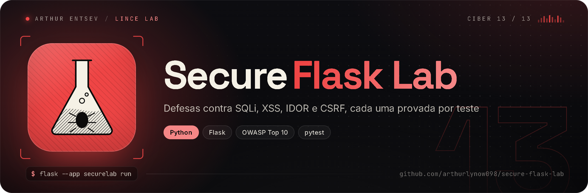
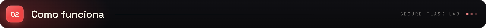
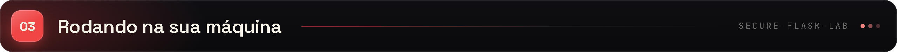
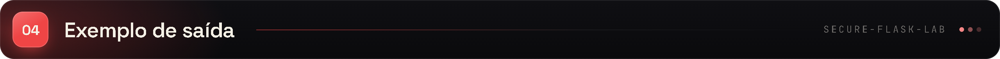
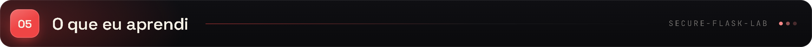
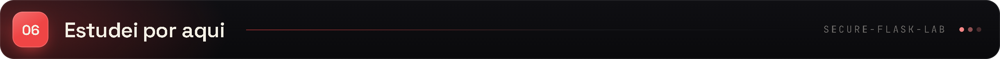

<a id="top"></a>

<p align="center"></p>

<p align="center">


<a href="https://github.com/arthurlynow098/secure-flask-lab/actions/workflows/testes.yml"></a>
</p>

<p align="center"><a href="#sobre">Sobre</a> &nbsp;&nbsp; <a href="#como-funciona">Defesas</a> &nbsp;&nbsp; <a href="#rodando">Rodando</a> &nbsp;&nbsp; <a href="#aprendi">O que aprendi</a> &nbsp;&nbsp; <a href="#estudos">Estudos</a></p>

<a id="sobre"></a>

<p></p>

Eu venho do desenvolvimento back-end, e a maior parte das vulnerabilidades web que estudei nasce de um descuido pequeno de quem escreveu o código. Uma consulta montada com concatenação de texto, um `|safe` esquecido no template, uma rota que confere se o usuário está logado mas não confere se a nota é dele.

O Secure Flask Lab é um app de anotações simples, com cadastro, login e busca, escrito com cada defesa no lugar certo. Todas estão marcadas no código com o comentário `DEFESA`, e **cada uma tem um teste automatizado que prova que ela funciona**. A ideia é ter um projeto que eu consiga abrir numa entrevista e explicar linha por linha.

<a id="como-funciona"></a>

<p></p>

| Risco (OWASP Top 10) | Defesa no código | Teste que prova |
|---|---|---|
| **A03 Injection** | Toda consulta usa parâmetros `?` do sqlite3. O que o usuário digita nunca vira SQL | `test_busca_trata_aspas_como_texto` |
| **A03 Injection, XSS** | Autoescape do Jinja ligado e nenhum `\|safe` em conteúdo do usuário, mais CSP restritivo | `test_html_do_usuario_sai_escapado` |
| **A01 Broken Access Control, IDOR** | O `dono_id` da sessão entra no `WHERE`. Responde 404 em vez de 403 para nem confirmar que a nota existe | `test_nao_acessa_nota_alheia_trocando_o_id` |
| **A01, CSRF** | Token aleatório por sessão em todo formulário, comparado em tempo constante | `test_post_sem_csrf_e_recusado` |
| **A02 Cryptographic Failures** | Senha com hash scrypt e salt (`werkzeug.security`) | `test_senha_nao_fica_em_texto_puro` |
| **A07 Authentication Failures** | Mesma mensagem para usuário inexistente e senha errada, sessão renovada no login | `test_login_errado_tem_mensagem_generica` |
| **A05 Security Misconfiguration** | CSP, `nosniff`, `Referrer-Policy`, `Permissions-Policy` e cookie `HttpOnly` com `SameSite` | `test_cabecalhos_de_seguranca` e `test_cookie_de_sessao_httponly` |

Um trecho que resume a ideia, a rota que mostra uma nota

```python
# DEFESA o dono entra no WHERE, então trocar o número na URL não mostra nota alheia (IDOR)
nota = db().execute("SELECT * FROM notas WHERE id = ? AND dono_id = ?",
                    (nota_id, session["user_id"])).fetchone()
if nota is None:
    abort(404)
```

**Um bug que os testes pegaram.** Na primeira versão, o login limpava a sessão (o que é certo) e com isso o token CSRF sumia. Aí um POST sem token comparava texto vazio com texto vazio e passava. O teste `test_post_sem_csrf_e_recusado` falhou, eu entendi o motivo e corrigi exigindo que o token esperado exista. Foi a melhor demonstração de por que vale escrever teste para segurança.

<a id="rodando"></a>

<p></p>

```bash
git clone https://github.com/arthurlynow098/secure-flask-lab.git
cd secure-flask-lab
pip install flask

flask --app securelab run
# abra http://127.0.0.1:5000/registrar
```

O banco SQLite é criado sozinho na pasta `instance/`. Em produção defina a variável `SECRET_KEY` e `FLASK_ENV=production` para o cookie ganhar a flag `Secure`.

Testes

```bash
pip install -r requirements-dev.txt
python -m pytest -q
```

<p></p>

```text
$ python -m pytest -v

tests/test_defesas.py::test_precisa_login PASSED
tests/test_defesas.py::test_senha_nao_fica_em_texto_puro PASSED
tests/test_defesas.py::test_login_errado_tem_mensagem_generica PASSED
tests/test_defesas.py::test_busca_trata_aspas_como_texto PASSED
tests/test_defesas.py::test_busca_nao_mostra_nota_de_outro_usuario PASSED
tests/test_defesas.py::test_html_do_usuario_sai_escapado PASSED
tests/test_defesas.py::test_nao_acessa_nota_alheia_trocando_o_id PASSED
tests/test_defesas.py::test_post_sem_csrf_e_recusado PASSED
tests/test_defesas.py::test_cabecalhos_de_seguranca PASSED
tests/test_defesas.py::test_cookie_de_sessao_httponly PASSED

10 passed
```

<a id="aprendi"></a>

<p></p>

- Consulta parametrizada resolve injeção de SQL de vez, não precisa "limpar" a entrada na mão
- Autenticação (quem é você) e autorização (o que você pode ver) são verificações diferentes, e IDOR acontece quando só a primeira existe
- Como funciona um token CSRF e por que o `SameSite` ajuda mas não substitui ele
- Escrever teste que prova a defesa, e não só que a tela abre
- Pequenos detalhes de login que evitam enumeração de usuário e fixação de sessão

Próximos passos

- [ ] Limite de tentativas de login por IP
- [ ] Trocar o SQL na mão por SQLAlchemy e comparar
- [ ] Rodar o OWASP ZAP contra o app e documentar o resultado

<a id="estudos"></a>

<p></p>

Segui essas aulas e materiais para entender e aplicar tudo que está aqui.

| Material | O que tirei dele |
|---|---|
| [OWASP Top 10](https://owasp.org/Top10/) | As categorias de risco usadas na tabela acima |
| [PortSwigger Academy, SQL injection](https://portswigger.net/web-security/sql-injection) | Como a injeção acontece e por que parâmetros resolvem |
| [PortSwigger Academy, Cross-site scripting](https://portswigger.net/web-security/cross-site-scripting) | Tipos de XSS e o papel do escape de saída e do CSP |
| [PortSwigger Academy, IDOR](https://portswigger.net/web-security/access-control/idor) | Controle de acesso por objeto |
| [OWASP SQL Injection Prevention Cheat Sheet](https://cheatsheetseries.owasp.org/cheatsheets/SQL_Injection_Prevention_Cheat_Sheet.html) | Consultas parametrizadas como defesa principal |
| [Tutorial oficial do Flask](https://flask.palletsprojects.com/en/stable/tutorial/) | Estrutura do app, factory e banco SQLite |

<p align="center"><sub>Parte do <a href="https://github.com/arthurlynow098">Lince Lab</a>, minha coleção de projetos de cibersegurança</sub></p>

<p align="center"><a href="#top">Voltar ao topo</a></p>
